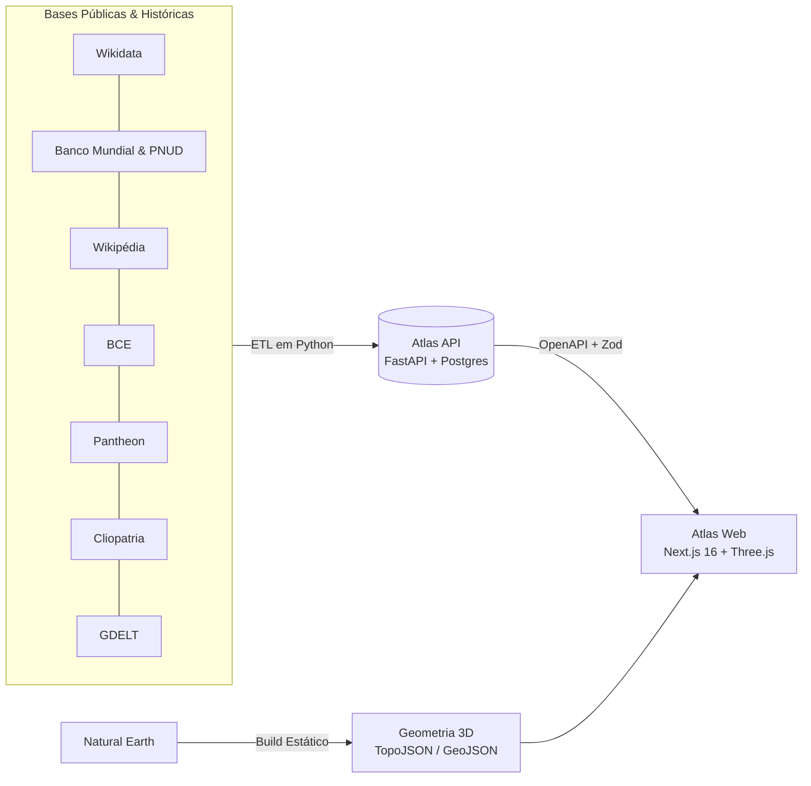

<p align="center">
  
</p>

<p align="center">
  <a href="#sobre-o-atlas">Sobre</a> ·
  <a href="#princípios">Princípios</a> ·
  <a href="#o-que-dá-para-explorar">Funcionalidades</a> ·
  <a href="#arquitetura-e-fontes">Arquitetura</a> ·
  <a href="#repositórios">Repositórios</a> ·
  <a href="https://atlas-web-ruddy.vercel.app"><strong>Abrir o Atlas ↗</strong></a>
</p>

<h3 align="center">Um globo 3D para explorar os países do mundo: política, história, economia e como vive o povo.</h3>

---

## Sobre o Atlas

O **Atlas** é um observatório interativo em 3D que reúne fatos, séries históricas, geopolítica e indicadores socioeconômicos de **197 países** e **3.754 subdivisões** em uma única interface. 

Cada número, fronteira ou resumo exibe explicitamente sua origem, ano de referência e licença — transformando dados brutos de instituições internacionais e bases históricas em exploração visual direta no navegador.

---

## Princípios

```text
nenhum dado inventado → fonte em todo bloco → contrato tipado ponta a ponta
```

* **Nenhum dado inventado:** dado ausente aparece como *"sem dados"*. Qualquer texto sintetizado ou não verificado recebe aviso explícito na interface.
* **Fonte em todo bloco:** cada indicador exibe de onde veio, o ano da coleta e sua licença de uso.
* **Fonte única de verdade:** o frontend conversa exclusivamente com a **Atlas API**, sem chaves expostas nem chamadas dispersas no navegador.
* **Rigor de contrato:** os tipos TypeScript do cliente são gerados a partir do OpenAPI da API e validados contra schemas Zod em tempo de compilação.

---

## O que dá para explorar

| Recurso | O que oferece |
| :--- | :--- |
| **Painel do País** | Bandeira projetada sobre o território (incluindo arquipélagos), resumo revisado sem acréscimo de fatos, governantes, pessoas notáveis e indicadores de qualidade de vida com posição no ranking mundial. |
| **Estados e Províncias** | Camada com **3.754 subdivisões** em 240 territórios, exibindo bandeira estadual sobre o mapa, capital, população, área e código ISO 3166-2. |
| **Camadas & Rankings** | Visualização global por **Regime Político** (paleta acessível para daltonismo), **Bandeiras**, cobertura **GeoGuessr / Street View** e **37 indicadores** comparativos com Top 10. |
| **Viagem no Tempo** | Linha do tempo de **3400 a.C. a 2024** alterando fronteiras e estilos cartográficos conforme cada era histórica (*Cliopatria*). |
| **Economia & Câmbio** | Composição do PIB, dependência de recursos naturais, pauta de exportações e conversor histórico de moedas em base 100 desde 1999 (*BCE*). |
| **História, Notícias & Glossário** | Linha do tempo condensada com link para a revisão exata da Wikipédia, manchetes geopolíticas atualizadas a cada 6 horas (*GDELT*) e glossário temático integrado ao globo. |

---

## Arquitetura e Fontes



### Stack do Ecossistema

| Camada | Tecnologias |
| :--- | :--- |
| **Frontend (`atlas-web`)** | TypeScript (strict), Next.js 16 (App Router), React 19, `react-globe.gl` / Three.js, `d3-geo`, Zod, Vitest, Playwright |
| **Backend (`atlas-api`)** | Python, FastAPI, PostgreSQL, pipelines de ETL automatizados e especificação OpenAPI |
| **Desenvolvimento Orientado a Specs** | Toda feature nasce como uma especificação numerada (`specs/`), sincronizada entre API e Web |

---

## Repositórios

| Repositório | Papel no Ecossistema | Links |
| :--- | :--- | :--- |
| **[atlas-web](https://github.com/NOME-DA-ORG/atlas-web)** | Globo 3D com shaders customizados, páginas SSG/ISR por país, camadas temáticas e visualizações | [Aplicação Web ↗](https://atlas-web-ruddy.vercel.app) |
| **[atlas-api](https://github.com/NOME-DA-ORG/atlas-api)** | API REST, ingestão de dados, regras de agregação e contratos OpenAPI | [Swagger / Docs ↗](https://atlas-api.fastapicloud.dev/docs) |

---

<p align="center">
  Dados provenientes de <strong>Natural Earth</strong>, <strong>Wikidata</strong>, <strong>Banco Mundial</strong>, <strong>PNUD</strong>, <strong>BCE</strong>, <strong>Wikipédia</strong>, <strong>Pantheon</strong>, <strong>Cliopatria</strong> e <strong>GDELT</strong>.<br/>
  Código aberto sob licença <strong>MIT</strong>.
</p>
